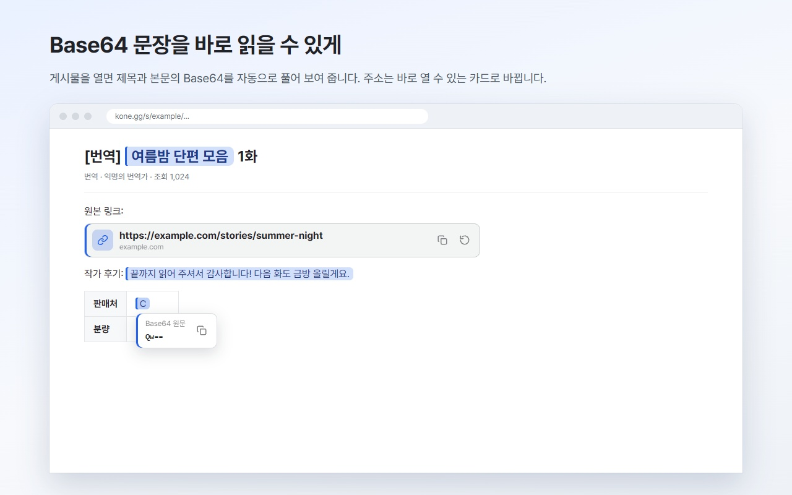

# 코네 Base64 디코더

코네(kone.gg)에서 Base64로 적힌 문장을 자동으로 풀어 보여 주는 브라우저 확장 프로그램입니다. 복사해서 디코더 사이트에 붙여 넣을 필요 없이, 페이지를 열기만 하면 읽을 수 있는 글로 바뀝니다.

> 코네(kone.gg)와 관계없는 비공식 도구입니다.

## 기능

- **풀어 주는 곳:** 게시물 제목과 본문, 글 목록 제목(게시판, 검색 결과, 홈 화면 미리보기, 프로필의 게시글 목록). 댓글은 건드리지 않습니다.
- **주소는 카드로:** 풀린 결과가 `https://` 주소면 바로 열 수 있는 카드로 보여 주고, 복사·원문 보기 버튼을 붙입니다.
- **문장은 파란 표시로:** 누르면 Base64 원문을 보고 복사할 수 있습니다.
- **겹친 인코딩:** 두 번 이상 인코딩된 문장도 끝까지 풉니다.
- **오탐 방지:** 영어 단어, 작품 코드, 해시값, `HP=100` 같은 일반 글과 바이너리(이미지 등)는 그대로 둡니다.
- **화면 전환 대응:** 글 이동, 페이지 넘김, 뒤로·앞으로 가기처럼 새로고침 없는 전환도 따라갑니다.
- **라이트·다크 모드:** 코네의 화면 모드에 맞춰 보입니다.
- **켜기·끄기:** 툴바의 확장 아이콘을 눌러 자동 디코딩을 켜고 끌 수 있고, 열린 코네 탭에 바로 적용됩니다.

## 설치

- **Chrome 웹 스토어:** 심사 중입니다. 등록되면 여기에 링크를 걸겠습니다.
- **소스에서 직접 설치(개발용):** 저장소를 내려받고 `chrome://extensions` → 개발자 모드 켜기 → "압축해제된 확장 프로그램을 로드합니다"에서 저장소 폴더를 고릅니다. 삼성 인터넷(PC)은 "압축 해제된 추가 기능 불러오기"로 같은 폴더를 고릅니다.

Chrome, Edge, 삼성 인터넷(PC) 등 Chromium 계열 브라우저에서 동작합니다(Manifest V3).

## 개인정보

어떤 정보도 수집하거나 외부로 보내지 않습니다. 모든 처리는 브라우저 안에서 이루어지고, 저장하는 것은 켜기·끄기 설정 하나뿐입니다. 자세한 내용은 [개인정보처리방침](PRIVACY.md)을 보세요.

## 개발

- **브랜치:** git flow 방식. `main`은 배포본, `develop`은 개발 통합 브랜치, 기능은 `feature/*`에서 만들어 `develop`에 `--no-ff`로 병합합니다. 배포 때는 `release/*`, 긴급 수정은 `hotfix/*`.
- **테스트:** Node.js 20 이상에서 `npm test` (`node --test`).
- **화면 확인:** 저장소 폴더에서 `python -m http.server 5173`을 실행하고 `http://localhost:5173/tests/fixtures/` 아래 페이지를 엽니다. 확장 없이 코네 구조를 본뜬 페이지에서 콘텐츠 스크립트를 돌려 볼 수 있습니다(가짜 chrome API 사용).
  - `kone-post.html`: 게시물
  - `kone-list.html`: 글 목록
  - `stress.html`: 부하 테스트(3000문단과 계속 바뀌는 시계)
  - `popup.html`: 실제 팝업을 흉내 페이지에 연결
- **패키징:** `npm run pack` → `dist/kone-base64-decoder-<버전>.zip`. manifest.json, icons/, src/만 넣습니다. 버전은 manifest.json과 package.json을 함께 올립니다.
- **구조:** 코네 화면 구조에 의존하는 선택자는 `src/content/selectors.js` 한 곳에 모았습니다. 감지·디코딩 로직은 `src/lib/base64.js`에 있고 DOM에 의존하지 않습니다.
- **스토어 자료:** 등록 문구와 개인정보 답변은 `store/listing.md`에 있습니다. 스크린샷과 홍보 타일은 `node scripts/store-shots.js`로 `store/images/`에 다시 만듭니다. 헤드리스 Chrome·Edge를 쓰고, 브라우저를 못 찾으면 `BROWSER` 환경 변수로 경로를 지정합니다.
- **아이콘:** `scripts/icons.html`을 브라우저로 열어 다시 그릴 수 있습니다(결과는 `icons/`).
- **팝업 폰트:** Pretendard JP에서 팝업에 쓰는 글자만 남긴 가변 폰트 `src/popup/fonts/popup-sans.woff2`(약 55KB)입니다.
  - OFL에 따라 수정본 이름은 "Popup Sans"입니다.
  - 팝업 문구를 바꾸면 `python scripts/subset-font.py <PretendardJPVariable.woff2>`로 다시 만듭니다(fonttools, brotli 필요).

## 라이선스

[MIT](LICENSE). 팝업 폰트(Pretendard JP 기반)는 [SIL Open Font License 1.1](src/popup/fonts/OFL.txt)을 따릅니다.
