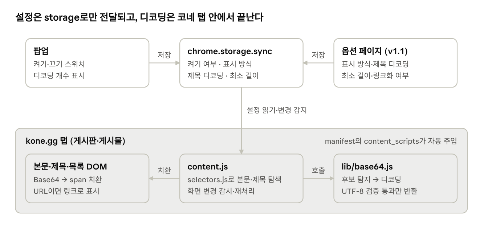

# 코네(kone.gg) 전용 Base64 자동 디코딩 확장 프로그램 설계 계획서

작성일: 2026-11-26

## 개요와 목표

코네(kone.gg) 게시물에 들어 있는 Base64 문장을 찾아 읽을 수 있는 글로 자동 디코딩해 보여주는 Manifest V3 브라우저 확장 프로그램이다. 사이트마다 프레임워크와 DOM 구조가 달라 범용으로는 정확도를 보장하기 어렵기 때문에, 대상을 코네 하나로 좁혔다. 모든 처리는 브라우저 안에서 끝나고 외부 서버로 아무것도 보내지 않는다.

- **해결할 문제**: Base64 문장을 볼 때마다 복사해서 외부 디코더에 붙여넣는 번거로움.
- **목표**: 코네 게시물을 열기만 하면 디코딩 결과가 바로 보이고, 필요하면 원문으로 되돌려 볼 수 있다.
- **포함 범위**: Chrome·Edge(Chromium 계열), kone.gg의 게시물 본문·게시물 제목·게시판 목록 제목, 표준 Base64와 URL-safe Base64, UTF-8 텍스트 결과.
- **제외 범위(1차)**: 댓글(필요해지면 추가), 코네 외 사이트, Safari, 이미지·파일 등 바이너리 Base64, Hex·ROT13 같은 다른 인코딩. Firefox는 이후 지원할 예정이라 처음부터 대비해 둔다.

## 구현 방식

사용자 스크립트(Tampermonkey 등) 대신 **확장 프로그램으로 확정**했다. 코네 전용으로 바뀌면서 처음에 꼽았던 '설정에서 사이트 등록'과 '사이트별 최소 권한' 이유는 더 이상 해당되지 않고, 아래 이유가 남는다.

- **설치 간편성**: 관리자 확장 설치와 "사용자 스크립트 허용" 설정 같은 사전 작업 없이 한 번에 설치된다.
- **설정 UI**: 켜기·끄기, 표시 방식 같은 설정을 팝업과 옵션 페이지로 제공할 수 있다.
- **안정성**: Chrome의 사용자 스크립트 정책 변화에 영향을 받지 않는다.
- **포기한 것**: 파일 하나로 끝나는 빠른 개발, 심사 없는 배포, Safari·모바일 동시 지원. 감지·디코딩 로직(`lib/base64.js`)은 환경에 의존하지 않게 두어, 필요하면 나중에 스크립트 판을 따로 만들 수 있다.

## 대상 사이트 분석: kone.gg

대상은 `https://kone.gg/*` 하나이고, 시험 게시판은 `/s/somisoft`다. 2026-11-26에 게시판 목록과 게시물을 열어 확인한 구조는 아래와 같다.

| 항목 | 확인 내용 | 설계 반영 |
| --- | --- | --- |
| 본문 위치 | `#post-article .article-prose` (읽기 전용 tiptap 렌더링) | 고정 본문 선택자 |
| 게시물 제목 | `#post-article header h1` (링크 아님) | 본문과 같이 클릭으로 원문 전환. 브라우저 탭 제목(`document.title`)은 건드리지 않는다 |
| 목록 제목 | 각 행이 `<a>` 링크이고, 제목은 `span.overflow-hidden.text-nowrap.text-ellipsis`에 있다. 데스크톱용(`div.hidden.md:block`)과 모바일용(`div.md:hidden`) 레이아웃이 한 행에 함께 있고, 행의 `div[title]` 속성에 전체 제목이 들어 있다. 같은 클래스의 `span`이 작성자 칸 등에도 쓰여 행마다 4개다 | 두 레이아웃의 제목 `span`만 고른다. 링크라서 클릭 전환 대신 툴팁으로 원문을 보여준다 |
| 게시물 화면의 목록 | 게시물을 열면 본문 아래에 같은 게시판 목록이 함께 그려진다 | 한 화면에서 게시물 제목·본문·목록 제목을 모두 처리한다 |
| 댓글 위치 | `#post-comment` | 현재 범위에서 제외. 나중에 필요하면 선택자만 추가한다 |
| Base64 형태 | `링크: aHR0cHM6…`처럼 일반 텍스트 안의 52자 표준 Base64. 디코딩하면 `https://`로 시작하는 URL | 결과가 URL이면 링크로 표시한다(F6) |
| 짧은 Base64 | 제목에 `Qw==`(4자) 같은 짧은 문자열이 쓰이고, 목록에는 `RJ071591` 같은 작품 코드도 섞여 있다 | 제목은 별도 기준(4자 + 패딩 규칙)을 둔다(F3) |
| 오탐 후보 | 페이지 스크립트에 22자 게시물 ID(`c2ArRWdThcQlvW0oQ56j0b` 형태)가 수십 개 있다 | 선택자로 범위를 제한하고 UTF-8 필터로 걸러낸다. 테스트 케이스에 추가 |
| 프레임워크 | SvelteKit. 텍스트 노드를 Svelte가 관리한다(주석 마커 사이) | 화면 준비(하이드레이션)가 끝난 뒤 처리하고, 다시 그려지면 MutationObserver로 재처리한다 |
| 페이지 이동 | 게시물 이동과 목록 페이지 넘김(`?p=2`) 모두 새로고침 없이 화면만 바뀐다(2026-11-26 확인) | 콘텐츠 스크립트는 한 번만 주입되므로, 본문·제목·목록 교체를 감시해 다시 처리한다 |

게시판과 게시물은 로그인 없이도 열려서, 수동 테스트를 이 게시판에서 바로 할 수 있다. 코네가 화면 구조를 바꾸면 선택자가 깨질 수 있다. 그래서 선택자는 `src/content/selectors.js` 한 곳에 모으고, 본문이나 목록을 찾지 못하면 팝업에 알린다(F9). 목록 제목은 클래스만으로는 작성자 칸과 구분되지 않으므로, "행 안 제목 칸의 `span`"처럼 위치로 고른다(정확한 선택자는 M4에서 확정).

## 사용자 시나리오

사용자는 확장을 설치하기만 하면, 따로 설정하지 않아도 코네 게시물에서 디코딩된 본문을 본다.

1. **설치**: 개발 중에는 `chrome://extensions` → 개발자 모드 → "압축해제된 확장 프로그램을 로드합니다"로 설치하고, 안정화 뒤에는 Chrome 웹 스토어에서 설치한다. 설치할 때 "kone.gg의 데이터 읽기 및 변경" 권한 안내가 한 번 나온다.
2. **게시판 보기**: 게시판 목록을 열면 제목 속 Base64가 디코딩된 채 보인다. 예: 제목 `Qw==` → `C`. 제목에 마우스를 올리면 원문이 툴팁으로 나온다.
3. **게시물 열기**: 게시물을 열면 제목과 본문 속 Base64 문장이 디코딩 결과로 바뀌어 강조 표시된다. 예: `7JWI64WV7ZWY7IS47JqU` → `안녕하세요`. 여러 번 겹쳐 인코딩된 문장도 끝까지 풀리고, 결과가 URL이면 클릭할 수 있는 링크로 보인다.
4. **원문 확인**: 본문·게시물 제목의 일반 텍스트 결과는 클릭하면, 링크 결과는 옆의 ↺ 버튼을 누르면 원래 Base64 문장과 디코딩 결과가 번갈아 보인다.
5. **이동**: 새로고침 없이 다른 게시물로 넘어가거나 목록 다음 페이지로 넘겨도 새 제목·본문이 디코딩된다.
6. **끄기**: 툴바 아이콘 팝업에서 전체를 켜고 끈다. 세부 설정은 옵션 페이지(v1.1)에서 바꾼다.

## 기능 요구사항

1차 버전(v1.0)은 F1–F7을 구현한다. 가장 중요한 대상은 게시물 본문, 게시물 제목, 게시판 목록 제목이고, 댓글은 지금 범위에서 뺐다. 사이트 등록·본문 영역 입력 기능은 코네 전용으로 바뀌면서 빠졌다.

| ID | 기능 | 내용 | 버전 |
| --- | --- | --- | --- |
| F1 | 코네 고정 대상 | manifest에 `https://kone.gg/*`만 선언하고, 본문·제목·목록 선택자는 코드에 고정한다 | v1.0 |
| F2 | 본문 디코딩 | 본문 텍스트에서 후보를 찾고, 정상적인 UTF-8 텍스트로 풀리는 것만 바꾼다. 여러 번 인코딩된 문장은 끝까지 푼다 | v1.0 |
| F3 | 제목·목록 제목 디코딩 | 게시물 제목과 게시판 목록 제목도 디코딩한다(기본 켬). 짧은 Base64가 많아 4자부터 보되, 16자 미만은 `=` 패딩이 있을 때만 바꾼다 | v1.0 |
| F4 | 강조 표시·원문 전환 | 디코딩된 부분을 색으로 표시한다. 본문·게시물 제목의 텍스트는 클릭, 링크는 ↺ 버튼으로 원문과 결과를 전환한다. 목록 제목은 링크 안이라 클릭 전환 대신 툴팁으로 원문을 보여준다. 툴팁에 디코딩 단계 수도 표시한다 | v1.0 |
| F5 | 화면 전환 대응 | 새로고침 없는 게시물 이동과 목록 페이지 넘김으로 바뀐 내용도 처리한다 | v1.0 |
| F6 | URL 결과 링크화 | 본문 결과가 http·https URL이면 새 탭으로 여는 링크로 표시한다(제목은 텍스트로만 표시) | v1.0 |
| F7 | 팝업 | 전체 켜기·끄기, 현재 탭의 디코딩 개수 | v1.0 |
| F8 | 옵션 페이지 | 표시 방식, 제목 디코딩 켜기·끄기, 영역별 최소 길이, 링크화 여부 등 세부 설정 | v1.1 |
| F9 | 구조 변경 알림 | 선택자로 본문이나 목록을 찾지 못하면 팝업에 "코네 화면 구조가 바뀌었을 수 있음"을 표시한다 | v1.1 |
| F10 | 댓글 디코딩 | `#post-comment` 안의 Base64도 디코딩한다(옵션) | 필요하면 |
| F11 | Firefox 지원 | Firefox용 manifest 설정, 권한 안내, 부가 기능 사이트 등록 | 이후 |

**비기능 요구사항**

- 프라이버시: 네트워크 요청 0건. 페이지 내용은 저장하지도 보내지도 않는다.
- 성능: 본문 처리를 디바운스해 모아서 하고, 페이지 스크롤이 끊기지 않게 한다.
- 안전: 디코딩 결과는 항상 텍스트로만 넣는다(HTML로 해석하지 않음).
- 언어: 코네가 한국어 사이트이므로 설정 화면은 한국어만 지원한다.
- 이식성: 브라우저 API 호출은 `browser-api.js` 한 곳에서만 해, Firefox로 옮길 때 고칠 곳을 줄인다.

## 아키텍처

확장은 팝업·옵션 페이지와 콘텐츠 스크립트 두 부분뿐이고, 둘은 `chrome.storage`로만 설정을 주고받는다. 권한 요청과 스크립트 등록이 필요 없어 서비스 워커는 두지 않는다.



kone.gg 페이지를 열면 브라우저가 manifest에 적힌 스크립트를 자동으로 주입하고, `content.js`가 설정을 읽은 뒤 게시물 본문·게시물 제목·목록 제목을 디코딩한다. 팝업에서 설정을 바꾸면 열려 있는 탭에도 새로고침 없이 바로 반영된다.

## Base64 감지·디코딩 알고리즘

후보는 넓게 찾고, "디코딩했을 때 정상적인 UTF-8 문장이 나오는가"로 엄격하게 걸러 오탐을 막는다.

1. **대상 범위**: `selectors.js`에 정한 세 영역(게시물 본문, 게시물 제목, 목록 제목) 안의 텍스트 노드만 `TreeWalker`로 순회한다. `script`, `style`, `noscript`, `textarea`, `input`, `contenteditable` 영역과 이미 처리한 노드는 건너뛴다.
2. **후보 탐지**: 아래 정규식으로 표준·URL-safe Base64 덩어리를 찾는다. 최소 길이는 영역마다 다르다.
    - 본문: 16자 이상.
    - 게시물 제목·목록 제목: 4자 이상. 단 16자 미만이면 끝에 `=`나 `==` 패딩이 있어야 한다(`Qw==`는 풀고 `RJ071591`은 건너뜀).
3. **1차 필터(디코딩 전)**:
    - 패딩을 뗀 길이가 4로 나눈 나머지 1이면 제외(유효한 Base64가 될 수 없음).
    - 대문자·소문자·숫자 중 2종류 이상이 섞여 있어야 한다(긴 영단어 제외).
4. **디코딩**: `-`→`+`, `_`→`/`로 바꾸고 패딩을 채운 뒤 `atob` → 바이트 배열 → `TextDecoder('utf-8', { fatal: true })`.
5. **2차 필터(디코딩 후)**:
    - UTF-8로 풀리지 않으면 제외(Hex 해시·랜덤 토큰 대부분이 여기서 걸러짐).
    - 제어문자(탭·줄바꿈 제외)가 하나라도 있으면 제외.
6. **중첩 디코딩**: 결과 전체가 다시 Base64 모양이고 같은 영역 기준(최소 길이, 1·2차 필터)을 통과하면 한 번 더 푼다. 통과하지 못하는 단계에서 멈추며, 안전장치로 최대 10단계까지만 반복한다. Base64는 풀 때마다 길이가 약 3/4로 줄어 실제로는 몇 단계 안에 끝난다.
7. **DOM 치환**: 텍스트 노드를 `splitText`로 나누고, 해당 구간을 `<span class="b64d" data-b64d-original="…">`로 감싼다. 결과는 `textContent`로만 넣는다.
    - 본문: 결과가 http·https URL이면 `<a>`로 만들고 옆에 ↺ 버튼을 붙인다.
    - 게시물 제목: 텍스트로만 넣고 클릭으로 원문 전환.
    - 목록 제목: 텍스트로만 넣고 `span`에 `title="원문: …"`을 단다. 안쪽 요소의 `title`이 행의 `div[title]`보다 우선해 마우스를 올리면 원문이 보인다. 링크 이동을 막지 않도록 클릭 핸들러는 달지 않는다.
8. **동적 콘텐츠**: `MutationObserver`(`childList`·`characterData`)로 바뀐 노드를 모아 200ms 디바운스 후 한 번에 처리한다. 게시물 이동과 목록 페이지 넘김도 같은 경로로 처리한다. 확장이 넣은 `span`은 건너뛰어 무한 루프를 막는다.
    - 목록 행 재사용 대비: Svelte가 행을 새로 만들지 않고 텍스트만 바꿀 수 있다. 그래서 처리한 제목 `span`에 원래 제목을 기록해 두고, 행의 `div[title]` 값과 달라지면 되돌린 뒤 다시 처리한다(실제 동작은 M5에서 확인).

```js
// 후보 탐지: 앞뒤가 Base64 문자가 아닌 4자 이상 덩어리 (영역별 기준은 isCandidate에서)
const CANDIDATE = /(?<![A-Za-z0-9+\/=_-])[A-Za-z0-9+\/_-]{4,}={0,2}(?![A-Za-z0-9+\/=_-])/g;

// 본문: { minLength: 16 }, 게시물 제목·목록 제목: { minLength: 4, shortNeedsPadding: true }
function isCandidate(token, { minLength, shortNeedsPadding = false }) {
  if (token.length < minLength) return false;
  if (shortNeedsPadding && token.length < 16 && !token.endsWith('=')) return false;
  const kinds = [/[A-Z]/, /[a-z]/, /[0-9]/].filter(re => re.test(token)).length;
  return kinds >= 2;
}

function tryDecode(token) {
  let s = token.replace(/-/g, '+').replace(/_/g, '/').replace(/=+$/, '');
  if (s.length % 4 === 1) return null;
  s += '='.repeat((4 - (s.length % 4)) % 4);
  try {
    const bytes = Uint8Array.from(atob(s), c => c.charCodeAt(0));
    const text = new TextDecoder('utf-8', { fatal: true }).decode(bytes);
    return /[\u0000-\u0008\u000B\u000C\u000E-\u001F\u007F]/.test(text) ? null : text;
  } catch {
    return null;
  }
}

// 여러 번 인코딩된 문장을 끝까지 푼다. 반환값: { text, depth } 또는 null
function decodeDeep(token, opts, maxDepth = 10) {
  let text = tryDecode(token);
  if (text === null) return null;
  let depth = 1;
  while (depth < maxDepth) {
    const t = text.trim();
    if (!/^[A-Za-z0-9+\/_-]+={0,2}$/.test(t) || !isCandidate(t, opts)) break;
    const next = tryDecode(t);
    if (next === null) break;
    text = next;
    depth++;
  }
  return { text, depth };
}
```

## 설정 화면 설계

설정은 팝업과 옵션 페이지(v1.1) 두 곳에서 바꾸고 `chrome.storage.sync`에 저장한다. 사이트 등록 화면은 없다.

- **팝업(v1.0)**: 전체 켜기·끄기 스위치, 현재 탭에서 디코딩한 개수. v1.1에서는 구조 변경 알림(F9)도 여기에 띄운다.
- **옵션 페이지(v1.1)**: 팝업의 설정 + 표시 방식(치환 / 병기), 제목 디코딩 켜기·끄기(기본 켬), 영역별 최소 길이, URL 링크화 여부. v1.0에서는 이 값들을 기본값으로 고정해 쓴다.

```json
{
  "enabled": true,
  "display": "replace",
  "decodeTitles": true,
  "linkify": true,
  "minLength": { "body": 16, "title": 4 }
}
```

콘텐츠 스크립트는 `storage.onChanged`를 듣고 있다가 설정이 바뀌면 새로고침 없이 다시 적용한다. 끄면 치환한 `span`을 원문으로 되돌린다.

## 권한과 보안

대상이 코네 하나뿐이라 권한은 설치할 때 한 번에 받고, 실행 중에 추가로 요청하지 않는다. 콘텐츠 스크립트를 manifest에 고정해 두므로 서비스 워커도 필요 없다.

```json
{
  "manifest_version": 3,
  "permissions": ["storage"],
  "content_scripts": [{
    "matches": ["https://kone.gg/*"],
    "js": [
      "src/lib/browser-api.js",
      "src/lib/base64.js",
      "src/lib/settings.js",
      "src/content/selectors.js",
      "src/content/content.js"
    ],
    "css": ["src/content/content.css"],
    "run_at": "document_idle"
  }],
  "action": { "default_popup": "src/popup/popup.html" },
  "options_ui": { "page": "src/options/options.html", "open_in_tab": true }
}
```

- **설치 시 안내**: `content_scripts`의 `matches`만으로 "kone.gg의 데이터 읽기 및 변경" 한 줄이 표시된다. `host_permissions`는 따로 선언하지 않는다.
- **XSS 방지**: 디코딩 결과는 `textContent`로만 넣는다. 링크는 `http:`·`https:` 스킴만 `<a>`로 만들고 `target="_blank"`와 `rel="noopener noreferrer"`를 붙이며, `javascript:` 등 다른 스킴은 텍스트로 둔다. 링크 글자는 URL 전체를 그대로 보여준다.
- **원격 코드 없음**: 모든 코드를 패키지에 포함하고 `eval`을 쓰지 않아 MV3 정책과 기본 CSP를 따른다.
- **개인정보**: 저장하는 것은 설정값뿐이다. 페이지 내용·디코딩 결과는 저장하거나 전송하지 않는다.
- **Firefox 대비**: `options_page` 대신 Chrome·Firefox 모두 지원하는 `options_ui`를 쓴다. Firefox 버전(F11)에서는 `browser_specific_settings`(확장 ID)를 추가하고, Firefox가 사이트 접근 권한을 따로 허용받게 하는 경우에 대비해 권한이 없으면 팝업에 안내를 띄운다(실제 동작은 그때 확인).

## 프로젝트 구조

빌드 도구 없이 바닐라 JavaScript로 시작한다. 콘텐츠 스크립트는 ES 모듈을 직접 쓸 수 없으므로, manifest의 `js` 배열 순서대로 여러 파일을 넣는다. 코네 구조에 의존하는 부분은 `selectors.js`, 브라우저 API는 `browser-api.js` 하나로 모은다.

```text
kone-base64-decoder/
├─ manifest.json
├─ icons/                      16 · 32 · 48 · 128 px
├─ src/
│  ├─ content/
│  │  ├─ selectors.js          코네 본문·게시물 제목·목록 제목 선택자 (구조가 바뀌면 여기만 수정)
│  │  ├─ content.js            본문 탐색, DOM 치환, MutationObserver
│  │  └─ content.css           디코딩 표시 스타일
│  ├─ lib/
│  │  ├─ browser-api.js        chrome.* / browser.* 차이를 감추는 얇은 래퍼
│  │  ├─ base64.js             감지·디코딩·중첩 디코딩 순수 함수 (테스트 대상)
│  │  └─ settings.js           설정 기본값·읽기·쓰기
│  ├─ popup/                   popup.html · popup.js · popup.css
│  └─ options/                 (v1.1) options.html · options.js · options.css
├─ tests/
│  ├─ base64.test.js           node --test 로 실행
│  └─ fixtures/                kone-post.html · kone-list.html (코네 구조를 본뜬 가짜 페이지)
└─ package.json                테스트·패키징 스크립트
```

## 개발 단계

디코딩 코어(M2)를 먼저 테스트로 굳힌 뒤 화면에 붙이는 순서로 진행한다. 일정은 아직 정하지 않았다.

| 단계 | 작업 | 완료 기준 |
| --- | --- | --- |
| M1 골격 | manifest(kone.gg 콘텐츠 스크립트), `browser-api.js`, 팝업(켜기·끄기), `settings.js` | 개발자 모드로 로드되고, kone.gg에서만 콘텐츠 스크립트가 실행된다 |
| M2 디코딩 코어 | `lib/base64.js` 감지·디코딩·중첩 디코딩·영역별 기준 + 단위 테스트 | 테스트 계획의 정탐·오탐 케이스가 모두 통과한다 |
| M3 게시물 본문·제목 | `selectors.js`, 본문·게시물 제목 치환, 클릭 전환, URL 링크화 + ↺ 버튼 | `/s/somisoft` 게시물의 제목·본문 Base64가 자동 디코딩된다 |
| M4 목록 제목 | 목록 제목 선택자(데스크톱·모바일 레이아웃), 패딩 규칙, 원문 툴팁 | 목록 제목의 `Qw==`는 풀리고 `RJ071591`은 그대로 남으며, 클릭하면 게시물로 이동한다 |
| M5 화면 전환 대응 | MutationObserver, 게시물 이동·목록 페이지 넘김, 행 재사용 대비, 중복 처리 방지 | 새로고침 없이 게시물을 옮기거나 목록을 넘겨도 디코딩되고, 같은 문장을 두 번 처리하지 않는다 |
| M6 v1.0 마무리 | 아이콘, 팝업 디코딩 개수, 패키징 | 새 프로필에 설치해 시나리오 1–6을 통과한다 |
| M7 v1.1 | 옵션 페이지(F8), 구조 변경 알림(F9) | 설정 변경이 열려 있는 탭에 바로 반영된다 |
| M8 스토어 게시 | 스토어 등록 자료(아이콘·스크린샷·설명), 개인정보 항목, 공개 범위 결정 | Chrome 웹 스토어 심사를 통과한다 |
| M9 Firefox | `browser_specific_settings`, 권한 안내, Firefox 부가 기능 사이트 등록 | Firefox에서 시나리오 1–6을 통과한다 |

댓글 디코딩(F10)은 필요해지면 그때 단계를 추가한다. 선택자 하나와 영역 기준만 더하면 되도록 영역 처리를 일반화해 둔다.

## 테스트 계획

오탐이 가장 큰 위험이므로, 단위 테스트는 "바꾸면 안 되는 문자열"을 "바꿔야 하는 문자열"만큼 많이 넣는다.

| 입력 | 기대 결과 |
| --- | --- |
| `7JWI64WV7ZWY7IS47JqU` (한글 UTF-8) | `안녕하세요`로 치환 |
| 패딩(`=`)이 빠진 Base64 | 정상 디코딩 |
| URL-safe Base64 (`-`, `_` 포함) | 정상 디코딩 |
| 문장 중간에 끼어 있는 Base64 | 그 구간만 치환, 앞뒤 문장 유지 |
| 두 번 인코딩된 URL | 끝까지 풀려 URL 링크로 표시, 툴팁에 "2단계" |
| 디코딩 결과가 `javascript:alert(1)` | 링크가 아닌 텍스트로 표시 |
| `internationalization` (긴 영단어) | 그대로 둠 |
| SHA-256 Hex 해시 (64자) | 그대로 둠 |
| 본문 속 15자 이하 Base64 | 그대로 둠 (최소 길이 미달) |
| 게시물 제목 속 `Qw==` | `C`로 치환, 클릭하면 원문 |
| 목록 제목 속 `Qw==` | 데스크톱·모바일 레이아웃 모두 `C`로 치환, 마우스를 올리면 "원문: Qw==" 툴팁, 클릭하면 게시물로 이동 |
| 목록 제목 속 `RJ071591` | 그대로 둠 (16자 미만, 패딩 없음) |
| 목록 작성자·날짜 칸 | 건드리지 않음 |
| 목록 2페이지로 넘김 | 새 행의 제목도 디코딩, 이전 행의 치환이 새 제목에 남지 않음 |
| 제목 속 URL 결과 | 링크가 아닌 텍스트로 표시 |
| 이미지 등 바이너리 Base64 | 그대로 둠 (UTF-8 아님) |
| 디코딩 결과가 `` | 문자 그대로 보이고 실행되지 않음 |
| `textarea`·입력창 안의 Base64 | 그대로 둠 |
| 댓글 속 Base64 | 그대로 둠 (현재 범위 제외) |
| 코네 게시물 ID (22자, 예: c2ArRWdThcQlvW0oQ56j0b) | 그대로 둠 |

- **단위 테스트**: `node --test`로 `lib/base64.js`의 순수 함수만 검사한다.
- **수동 테스트**: `fixtures/kone-post.html`(정적 본문, 2초 뒤 추가되는 본문, 입력창 포함), `fixtures/kone-list.html`(두 레이아웃의 목록, 행 교체)과 kone.gg /s/somisoft 게시판에서 시나리오 1–6을 확인한다.
- **E2E(선택)**: Playwright로 확장을 로드해 fixture 페이지의 치환 결과를 자동 검사한다.

## 결정 사항

2026-11-26에 아래와 같이 정했다.

| 항목 | 결정 |
| --- | --- |
| 기본 표시 방식 | 원문을 결과로 치환. 일반 텍스트는 클릭, 링크는 옆 ↺ 버튼으로 원문 전환 |
| 최소 길이 | 본문 16자. 게시물 제목·목록 제목은 4자부터, 16자 미만이면 끝에 `=` 패딩이 있을 때만 |
| 중첩 인코딩 | 끝까지 푼다. 단계마다 같은 필터를 통과해야 하고, 안전장치로 최대 10단계 |
| URL 결과 | http·https만 새 탭으로 여는 링크로 표시 (v1.0) |
| 배포 | 개발 중에는 개발자 모드 설치, 안정화 후 Chrome 웹 스토어 게시 (공개 / 일부 공개는 M8에서 결정) |
| 처리 대상 | 게시물 본문, 게시물 제목, 게시판 목록 제목이 핵심(v1.0) |
| 제목 디코딩 | v1.0에 포함, 기본 켬(v1.1 옵션 페이지에서 끌 수 있음). 목록 제목은 툴팁으로 원문 표시 |
| 댓글 | 현재 구현에서 제외. 필요해지면 옵션으로 추가 (F10) |
| Firefox | 이후 지원. 처음부터 `browser-api.js`와 `options_ui`로 대비 |

**남은 확인 사항**

- 목록 제목 `span`의 최종 선택자, 목록 행 재사용 여부 (M4·M5)
- 스토어 공개 범위(공개 / 일부 공개)와 심사 통과 여부 (M8)
- Firefox의 사이트 접근 권한 동작 (M9)
